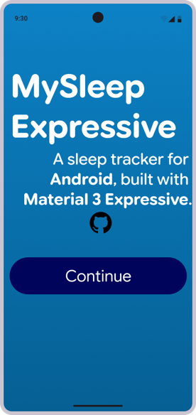

 <div align="center">


# MySleepExpressive

### A sleep tracker for Android, built with Material 3 Expressive.

A modern Android sleep-tracking app focused on sleep insights, a clean interface, and Google's expressive design language.

[](https://developer.android.com/)
[](https://kotlinlang.org/)
[](https://developer.android.com/compose)
[](https://m3.material.io/)

[](LICENSE)

</div>

---

## About

MySleepExpressive is an Android sleep-tracking app built with Kotlin, Jetpack Compose, and Material 3 Expressive. It aims to make understanding your sleep easier through a modern interface, sleep statistics, and tools for building healthier sleeping habits.

## Screenshots

<div align="center">

### Welcome Screen



</div>

## Features

- **Sleep Tracking**: Keep track of your sleeping habits and sleep duration.
- **Sleep Statistics**: Explore sleep data and identify patterns over time.
- **Sleep History**: Review previous nights and monitor your progress.
- **Sleep Goals**: Work towards a consistent sleep schedule.
- **Material 3 Expressive**: A modern Android interface with expressive components, typography, and motion.
- **Dynamic Colour**: Support for Android's dynamic colour system.
- **Light and Dark Themes**: A comfortable viewing experience across different lighting conditions.

*Features may change as development progresses.*

## Design

MySleepExpressive follows Google's Material 3 Expressive design language, focusing on:

- Expressive typography and shapes.
- Modern Material components.
- Smooth transitions and animations.
- Clean layouts and intuitive navigation.
- A cohesive Android experience.

## Built With

- [Kotlin](https://kotlinlang.org/)
- [Jetpack Compose](https://developer.android.com/compose)
- [Material 3](https://m3.material.io/)
- [Android SDK](https://developer.android.com/)

## Getting Started

1. Clone this repository:

   ```bash
   git clone https://github.com/YOUR_USERNAME/MySleepExpressive.git
   ```

2. Open the project in Android Studio.
3. Allow Gradle to synchronise.
4. Run the app on a compatible Android device or emulator.

Replace `YOUR_USERNAME` with your GitHub username.

## Disclaimer

MySleepExpressive was developed with assistance from **Claude AI by Anthropic**. AI assistance was used during development, with the project being refined according to the project's design goals and requirements.

MySleepExpressive is an independent project and is not affiliated with or endorsed by Google or Anthropic.

## Licence

This project is licensed under the **GNU General Public License v3.0 (GPL-3.0)**. See the [LICENSE](LICENSE) file for details.

---
## Quick Devlog

Currently the app is in Figma Design state, and only then we can start to create the app
---
<div align="center">

**MySleepExpressive**

*Designed for better sleep. Built for Android.*

</div>
